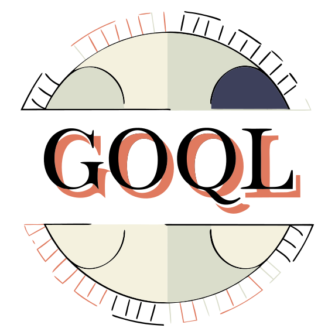

#

GoQL is a light, featureful graphql http client with 🔋 included.
{: .fs-6 .fw-300 }

[Get started now](installation){: .btn .btn-primary .fs-5 .mb-4 .mb-md-0 .mr-2 } [View it on GitHub](https://github.com/kushalshit27/goQL){: .btn .fs-5 .mb-4 .mb-md-0 }
